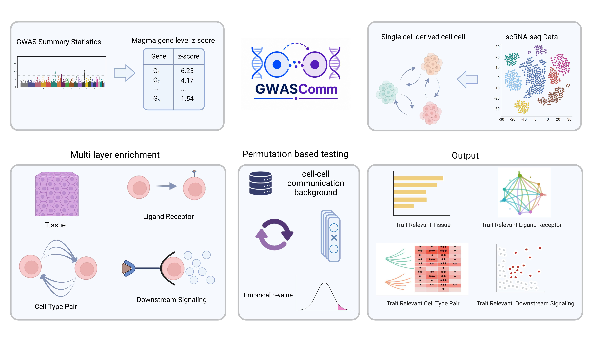

# GWASComm

**Connecting complex-trait genetics to the signals cells exchange.**

GWASComm integrates MAGMA gene-level GWAS scores with cell–cell communication
inferred from single-cell RNA sequencing. It identifies trait-associated
communication at four resolutions: **tissue, cell-type pair, ligand–receptor
interaction, and predicted downstream program**. The Python package is installed
and imported as `commgwas`.



## Why communication?

Genome-wide association studies identify trait-associated loci, but rarely reveal
the cellular contexts in which those loci act. Single-cell approaches help map
genetic signals to cell types, programs, and individual cells. Yet a cell's role
in disease may also depend on the signals it sends or receives.

GWASComm extends cell-centred analysis to intercellular communication, asking
whether active ligand–receptor interactions and their predicted targets are
enriched for trait-associated genes. These analyses nominate communication axes
for functional follow-up rather than establish causal signaling mechanisms.

In our analyses, GWASComm recovered monocyte-centred communication for monocyte
count and expected disease–tissue relationships across immune, cardiometabolic,
and neuropsychiatric traits. Ligand–receptor and downstream signals showed both
shared and distinct associations, highlighting complementary levels of
trait-associated communication.

## Four resolutions

| Resolution | Question | Function |
| --- | --- | --- |
| Tissue | Is the tissue's active communication program enriched for genetic signal? | `enrich_tissue()` |
| Cell-type pair | Which sender–receiver combinations carry enriched signal? | `enrich_cell_type_pairs()` |
| Ligand–receptor pair | Which individual interactions are associated with the trait? | `enrich_lr()` |
| Downstream program | Are a ligand's predicted targets enriched in the receiver context? | `enrich_downstream()` |

## Installation

Requires **Python 3.10 or later**. From the repository directory:

```bash
pip install -e .
```

For LIANA inference and AnnData-based expression filtering:

```bash
pip install -e ".[singlecell]"
```

## Quick start

Prepare a MAGMA table (`magma_df`) with gene symbols in `SYMBOL` and gene-level
z-scores in `ZSTAT`, an annotated AnnData object (`adata`), and the full LIANA
ligand–receptor resource (`lr_resource`). The resource must contain ligand and
receptor columns; it should not be restricted to significant interactions.

```python
import commgwas

lr_raw = commgwas.infer_lr(adata, cell_type_col="predicted.celltype.l2")
lr_sig = commgwas.filter_lr(lr_raw)

tissue = commgwas.enrich_tissue(lr_sig, magma_df, lr_resource=lr_resource)
cell_pairs = commgwas.enrich_cell_type_pairs(
    lr_sig, magma_df, lr_resource=lr_resource
)
lr_level = commgwas.enrich_lr(lr_sig, magma_df, lr_resource=lr_sig)
```

The default communication filter is `cellphone_pvals < 0.05`. To use a different
criterion, pass a query to `filter_lr()`:

```python
lr_sig = commgwas.filter_lr(
    lr_raw,
    filter_query="cellphone_pvals < 0.01 and aggregate_rank < 0.2",
)
```

For downstream enrichment, supply a NicheNet ligand–target prior as a wide matrix
with a `Target` column or a long table with ligand, target, and regulatory-potential
columns:

```python
downstream = commgwas.enrich_downstream(
    lr_results=lr_sig,
    adata=adata,
    magma=magma_df,
    nichenet="path/to/ligand_target_matrix.tsv",
    cell_type_col="predicted.celltype.l2",
    cellphone_p_cutoff=None,
    top_n_targets=300,
    expression_fraction_cutoff=0.05,
    min_genes=10,
)
```

Here, `cellphone_p_cutoff=None` avoids re-filtering the already selected LR table.
All enrichment functions return pandas DataFrames, including `observed_stat`,
`enrichment_z`, and the unadjusted `empirical_p`. Apply multiple-testing correction
externally across the relevant family of tests.

## Methods in brief

- **Genetic and communication inputs.** Run MAGMA separately to obtain gene-level
  z-scores, accounting for linkage disequilibrium and the chosen SNP-to-gene
  mapping windows. Match gene symbols to the communication annotations. Infer
  LR interactions with LIANA and filter independently of MAGMA scores.
- **Tissue and cell-type pairs.** Test the weighted mean of absolute MAGMA
  z-scores across unique ligand and receptor genes. Interaction weights combine
  maximum-scaled `lr_means` with `−log10(cellphone_pvals)` within each analysis
  unit; gene weights sum the contributions of their interactions. Permutations
  sample equally sized gene sets while holding the observed weights fixed.
  Supply the full LIANA resource as `lr_resource` for a competitive test against
  annotated communication genes with valid MAGMA scores.
- **Individual LR pairs.** The default statistic is
  $G_{ij}=\sqrt{\max(z_i,0)\max(z_j,0)}$. For complexes, the highest-scoring
  MAGMA-annotated subunit represents each component. Pairs without an annotated
  ligand or receptor are excluded. Set `lr_resource=lr_sig` to draw null pairs
  from genes in the active communication program. Repeated selected gene pairs
  share a test result across sender–receiver contexts.
- **Downstream programs.** For each LR context, rank NicheNet targets by
  regulatory potential and select the top 300 before retaining MAGMA-overlapping
  genes detected in at least 5% of receiver cells. Test their regulatory-potential-
  weighted mean absolute MAGMA score against size-matched samples from
  MAGMA-overlapping NicheNet targets. The current API uses regulatory-potential
  weights only; it does not implement the study's optional differential-expression
  weighting or expanded expression-based backgrounds.
- **Inference.** By default, tests use 5,000 permutations and `random_state=0`.
  One-sided empirical p-values use the plus-one correction:
  $P_{\mathrm{emp}}=(1+\#\{T_{\mathrm{perm}}\geq T_{\mathrm{obs}}\})/(1+N_{\mathrm{perm}})$.
  Enrichment z-scores standardize the observed statistic against the null
  distribution.

**Background choice matters:** the tissue, cell-type-pair, and LR functions use
all valid MAGMA genes when `lr_resource` is omitted. Pass it explicitly, as in the
quick start, to use the communication-specific backgrounds described here.
MAGMA gene-level z-scores summarize association evidence, not signed allelic
effects; taking their absolute values is a scoring choice, not an inference
about risk or protection.

## Tutorial and example data

See `tutorials/commgwas_blood_sle.ipynb` for a blood/SLE walkthrough covering all
four resolutions. The notebook uses these paths in the original project layout:

| Input | Project-relative path |
| --- | --- |
| MAGMA gene scores | `magma/magma_cao/DisCP0423_1.magma.genes.results.csv` |
| Single-cell data | `data/Blood_Hao/qc.h5ad` |
| NicheNet prior | `resource/ligand_target_matrix_nsga2r_final.tsv` |

These datasets are not bundled with the package. Supply your own files and
adjust the paths and cell-type metadata column (`predicted.celltype.l2`) as needed.
